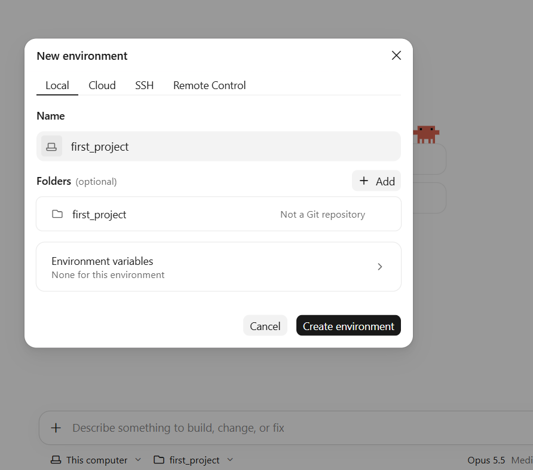

::::::: {.hero-section}
:::::: {.container}
::: {.hero-eyebrow}
Part 1 of 6 · about an hour
:::

::: {.hero-title}
Setup
:::

::: {.hero-subtitle}
Install the Claude desktop app, make a project folder, meet the agent, and let it set up Python for you
:::
::::::
:::::::

::: {.course-map}
[[⌂]{.n} Overview](index.qmd) [[1]{.n} Setup](setup.qmd){.here} [[2]{.n} First steps](first-steps.qmd) [[3]{.n} A paper in 50 minutes](live-demo.qmd) [[A]{.n} Assignment](assignment.qmd) [[4]{.n} After the course](after-the-course.qmd) [[5]{.n} Go further](go-further.qmd) [[6]{.n} AI in science](ai-in-science.qmd)
:::

## What do we do in this part?

Before a new research assistant can help, they need a desk, access to the right files, and the tools of the job. The agent is no different. In this part we install the app, make a folder for the agent to work in, have a first conversation with it, and let it install its own tools.

New here? Read the [overview](index.qmd) first: it explains what an agent is and what you need.

::: {.film}
```{=html}
<iframe src="assets/setup-in-a-minute.html" title="Setup in one minute: an animation of the five steps" loading="lazy" allowfullscreen></iframe>
```
The five steps in one minute. No sound. [Open it full screen](assets/setup-in-a-minute.html){target="_blank"}
:::

This part takes about an hour. The agent explains each step before it takes it, and you allow it. If something fails, nothing is broken. See the [troubleshooting table](#troubleshooting) at the end, or ask the agent what went wrong. Worried you will break something? The overview explains [why you can relax](index.qmd#worried-you-will-break-something).

:::: {.callout-note}
## Lost, or the screen looks different? Ask the AI

The Claude app gets a new version every few weeks, and the screens change with it. A button may have a new name, or sit somewhere else than in our text and pictures. Nothing is wrong when that happens, and you have not missed a step. What you do stays the same: open the app, choose a folder, talk to the agent.

Whenever you are lost, ask the AI, and give it this page. Copy the address of the page, paste it into the prompt box, and ask your question. For example:

::: {.prompt}
``` default
I am following this course: https://gabors-data-analysis.com/ai-course/friendly-agentic-ai-intro/setup.html
I am at Step 1.2. I am not sure how to set the folder I want to work in. Read the page, then tell me step by step what to click. If my app looks different from the page, check the current Claude Code documentation.
```
:::

The agent asks your permission to open the page: click **Allow once**. If the agent isn't running yet, ask the same in the **Chat** tab. The official [desktop app documentation](https://code.claude.com/docs/en/desktop) has the details.
::::

::: {.callout-note}
## What you will have at the end

- ☐ The Claude desktop app, with the **Code** tab working
- ☐ A project folder that the agent can read and write
- ☐ Python, set up by the agent for you
- ☐ A Markdown reader for the files the agent writes
:::

## [1.1]{.step-no} Install the Claude desktop app {#step-1-1}

::: {.callout-note}
## Which plan do I need?

The free Claude plan has no agent. For this course you need **Claude Pro**: \$20 a month, or \$17 a month paid for a year. You can cancel any time, so one month is enough to try. Prices as of November 2026; see [claude.com/pricing](https://claude.com/pricing).

- **Usage limits.** Every plan has a limit that resets every five hours, and a weekly one. Long sessions, large files and the strongest models use it up faster. When you hit it, you wait until it resets. Pro is enough for this course and for light regular use.
- **More usage.** **Max** (\$100 a month) gives five times the usage of Pro, and **Ultra** (\$200) more still. Move up only when you keep hitting the limit.
- **Through your university.** Ask whether it has a Claude **Team** or **Enterprise** plan. These include the agent, and conversations on them are not used to train models. On Pro and Max, training is a setting you choose in your account's privacy settings.
- **The alternatives** cost about the same: ChatGPT Plus (\$20) includes OpenAI's Codex, and Google AI Pro (about \$20) raises the limits of Antigravity, which also has a free tier. See the box below.
:::

The download page is [claude.com/download](https://claude.com/download). The links below lead to the same installers.

::: {.panel-tabset}
#### Windows
1. Download the installer: [Claude for Windows](https://claude.ai/api/desktop/win32/x64/setup/latest/redirect). (Some newer Windows laptops need a different installer. If **Settings → System → About** says *ARM-based processor*, use [this one](https://claude.ai/api/desktop/win32/arm64/setup/latest/redirect).)
2. Run the downloaded file. If Windows shows a blue "Windows protected your PC" box, click **More info → Run anyway**.
3. Open **Claude** from the Start menu and sign in with your Claude account.

#### Mac
1. Download the installer: [Claude for macOS](https://claude.ai/api/desktop/darwin/universal/dmg/latest/redirect). It works on Intel and Apple Silicon Macs.
2. Open the downloaded `.dmg` file and drag **Claude** into **Applications**.
3. Open Claude from Applications (or press `Cmd+Space`, type *Claude*) and sign in.

#### Linux
The desktop app for Linux is in beta, for Ubuntu 22.04 or later and Debian 12 or later. Follow the steps on the official page: [Claude Desktop on Linux](https://code.claude.com/docs/en/desktop-linux). Then start Claude from your application launcher and sign in.

On another distribution, use the terminal version of Claude Code: [install guide](https://code.claude.com/docs/en/quickstart). The rest of this course still applies. You type the same prompts in the terminal.
:::

**Then open the Code tab.** Its place has moved between versions of the app: look at the top of the window, or at the top of the left sidebar. If it asks you to upgrade, your plan doesn't include Claude Code.

::: {.callout-tip}
## Chat or Code?
The **Chat** tab is the chatbot you know. The **Code** tab is the agent. Don't let the name mislead you: Code is for any work on files in a folder, text included.
:::

::: {.callout-note collapse="true"}
## Using Codex or Antigravity instead? (click to open)

Two agents work much like Claude Code. Most of this course carries over: the project folder, `AGENTS.md`, planning first, small steps, and checking.

**Codex, by OpenAI.** The closest alternative. It comes with every ChatGPT plan: Free and Go include limited use, Plus and higher give more.

1. Install the ChatGPT desktop app, which now includes Codex. OpenAI's [instructions](https://learn.chatgpt.com/codex/app) have the download links. On Windows it comes from the Microsoft Store.
2. Sign in with your ChatGPT account and open Codex.
3. Open your project folder, and start with the setting that asks before every action.
4. Codex reads `AGENTS.md` by itself, so our starter file works as it is. Codex keeps skills in a different folder: ask Codex where to put them.

**Antigravity, by Google.** It runs Google's Gemini models. It is free to start, with weekly limits; Google AI Pro raises them. It looks more like a programmer's editor than a chat window.

1. Download it from [antigravity.google](https://antigravity.google/) (Mac, Windows, Linux).
2. Sign in with your Google account.
3. Open your project folder, and choose the setting where the agent asks for your review before it acts.
4. Ask the agent to read `AGENTS.md` at the start of each session, or copy its rules into the tool's own rules.

In both, the prompts of this course work as they are. The menus and the names of the settings differ, and they change often. When in doubt, ask the agent itself: *"How do I make you ask before every action?"*
:::

## [1.2]{.step-no} Make a project folder {#step-1-2}

The agent works inside **one folder**. Think of it as the desk you give to a new research assistant: what is on the desk, they can read and work on. What is not, they can't. Everything for a project goes there: data, code, notes, drafts, outputs. It is good practice to use a new folder for each project.

1. In your **Documents** folder, or in your Dropbox (see the box below), create a folder called `ai-projects`, and inside it a folder called `first-project`.
2. Use short names without spaces or accents (`first-project`, not `My First Project (ÁÉ)`). Programs handle plain names better.
3. Show file extensions: the letters after the dot in a file name, which tell you the type of the file (`.docx` is Word, `.md` is Markdown, `.csv` is a data table, `.py` is a Python script).
    - *Windows:* in File Explorer, click **View → Show → File name extensions**.
    - *Mac:* in Finder, open **Finder → Settings → Advanced** and tick **Show all filename extensions**.

The address of a file or folder on your computer is called its **path**. It lists the folders you go through to reach it, for example `C:\Users\anna\Documents\ai-projects\first-project` on Windows, or `/Users/anna/Documents/ai-projects/first-project` on a Mac. You will see paths in the agent's questions: they tell you where it wants to read or write.

::: {.callout-tip}
## Put the folder in Dropbox
If you use Dropbox, OneDrive or Google Drive, it is good practice to create `ai-projects` there rather than in Documents. These services keep earlier versions of each file. So you can go back in time: if the agent spoils a file, open its version history and restore yesterday's version. How far back you can go depends on your plan.

Git and GitHub do the same job more precisely, with a saved snapshot after each step that works. They take some setup. See [Step 4.4](after-the-course.qmd#step-4-4) in Part 4.
:::

**Open the folder in Claude.** In the Code tab, look at the row of controls under the prompt box. Your screen should look roughly like this.

::: {.ui-shot}
{fig-alt="The Claude Code tab with an empty prompt box. Under it, on the left, a control reading This computer and a folder control; on the right, the model Opus 5.5, the effort Medium, the permission mode and a small usage ring. A Choose environment button is in the middle of the screen."}
:::

Two controls on the left matter now.

- **The environment** says *where* the agent works. Choose **This computer**: the agent then works on your own laptop, with your own files.
- **The folder** says *which* folder it works in. Choose `first-project`.

If the middle of the screen says **Choose environment**, or the app asks you to set up a new environment, a window like this one opens:

::: {.ui-shot}
{fig-alt="The New environment window, with the tabs Local, Cloud, SSH and Remote Control. Local is selected. Below it are a Name field, a Folders list with an Add button, an Environment variables row, and the buttons Cancel and Create environment."}
:::

1. Keep the **Local** tab: the agent works on your computer. The other tabs are for running it in the cloud or on another computer, or for reaching it from elsewhere. We don't need them.
2. Give the environment a **Name**, such as `first-project`.
3. Under **Folders**, click **+ Add** and pick your `first-project` folder. *Not a Git repository* next to it is fine. Git is a tool that keeps a history of a folder, and the label only says that you don't use it. It comes later, if at all ([Step 4.4](after-the-course.qmd#step-4-4)).
4. Leave **Environment variables** alone, and click **Create environment**.

Then check the row under the prompt box: it should show your folder, or the environment you just created with your folder in it. If it shows another folder, click it and choose yours. Still lost? Ask the AI, as the box at the top of this page shows.

::: {.callout-warning}
## What not to put in the folder (yet)
The agent sends what it reads to the servers of Anthropic, the company that makes Claude. So keep confidential material out of the folder until you have checked your data agreement: interview recordings and transcripts, identifiable survey data, health records, anything under a data-use agreement, other people's unpublished work.

In the EU, the GDPR applies: interview transcripts and survey answers about people who can be identified are personal data, even when names are replaced by codes, and sending them to an AI company needs a legal basis and safeguards. Only fully and irreversibly anonymised data falls outside it. Ask your university's data protection officer before using such material, and see the European Commission's [What is personal data?](https://commission.europa.eu/law/law-topic/data-protection/reform/what-personal-data_en).

Also check your Claude account's privacy settings, which control whether your conversations may be used to train future models. For more, see [AI and your data](../da-knowledge/ai-and-your-data.qmd). For learning, public data and your own drafts are fine.
:::

## [1.3]{.step-no} Have a first conversation with the agent {#step-1-3}

**Choose the permission mode.** The permission mode, in the row under the prompt box, sets how much the agent may do without asking you. Your app may start in any of them, so check it before your first message. Four matter for us.

| Mode | What the agent does without asking | When to use it |
|---|---|---|
| **Manual** | Nothing. It asks before it changes a file and before it runs a command | When you start, and whenever the work matters: confidential material, the only copy of a file, anything hard to undo |
| **Accept edits** | Creates and edits files in the project folder. It still asks before other commands | Routine work in a folder you know |
| **Plan** | Reads and explores, then proposes a plan. It changes nothing | Before a longer task ([Step 2.3](first-steps.qmd#step-2-3)) |
| **Auto** | Works without routine questions. A background check stops actions it judges risky, such as ones that go beyond your request | Once you know how the agent works. Many experienced users work in Auto most of the time |

Leave **Bypass permissions** alone: it switches off the questions altogether.

The choice is yours, and you can change it at any time, in the middle of a session too. We advise **Manual** for this course and for your first week. True, it is slower. But you see every step, and you learn what the agent does. Later, Auto saves a lot of clicks. Its check cuts the questions, but the [documentation](https://code.claude.com/docs/en/permission-modes) says plainly that it does not guarantee safety. So go back to Manual when the work matters.

Next to the permission mode is the model picker. Leave the model that is already selected: we come back to it in [Which model should you use?](#which-model)

Type this and press Enter:

::: {.prompt}
``` default
Hi. I am new to this. What can you see in this folder? Then create a file called hello.md with three sentences about what you can do for a social scientist.
```
:::

The agent looks at the folder (it is empty), then asks to create a file. A box shows what it wants to do, with two buttons: **Deny** and **Always allow**. A third choice, **Allow once**, is hidden: click the small arrow next to the buttons to see it.

- **Allow once** lets the agent take this one step. Use it in this course: you see every step.
- **Always allow** lets it take this kind of step from now on without asking. Keep it for steps you have seen many times and trust.
- **Deny** stops the step. Nothing changes, and the agent waits for your instruction. When in doubt, deny.

Read what it wants to do. If it is unclear, click **Deny** and ask: *"What does this do? Explain in one sentence."*

Then try four things.

- Click `hello.md` in the chat. It opens inside the app.
- Ask: *"Make it two sentences and less formal."* The agent edits the file, not just the chat.
- The next time it asks to change the file, click **Deny**, on purpose. Nothing changes, and the agent waits for your instruction.
- Click the stop button to interrupt it. You can also type a correction while it works.

Note the second one. With a chatbot, you would get a new version in the conversation and copy it over. Here the file itself changed.

## [1.4]{.step-no} Let the agent set up Python {#step-1-4}

This is the most technical step of the course, and you don't need to follow the details. It takes five to ten minutes. The agent works by running *commands*: one-line instructions to the computer, such as "install Python". Read the one-sentence explanation before each command, then click **Allow once**.

**Why Python, if you work with text?** The agent writes small Python programs and uses them as its tools. Such a program is called a **script**: a text file of instructions that the computer carries out, one after the other. The agent uses scripts to read Word and PDF files, to convert formats, to handle large datasets and to draw charts. Python is free, it runs on every computer, and AI models write it well. You won't write any of it yourself.

Copy this prompt into the agent:

::: {.prompt}
``` default
I have never used Python. Please set up Python for this project folder.

- Use uv (a modern Python installer) to install Python and create an environment for this project only. Do not change anything else on my computer without asking.
- If this folder is in Dropbox, OneDrive or Google Drive, keep the environment outside it, and tell me where you put it.
- Before each command, tell me in one sentence what it does.
- Install these packages: pandas, matplotlib, openpyxl, pyreadstat, pymupdf, python-docx, pypandoc-binary, requests.
- Test it: write a short script code/00_test.py that makes a simple bar chart of five made-up numbers and saves it as output/test_chart.png. Run it.
- Finally write docs/SETUP-NOTES.md: what you installed, where it is, how to run a script, and how to undo all of it.
```
:::

::: {.callout-note}
## Python goes outside the folder, and that is fine

Python is a program, like Word or Typora. Like any program, it is installed on your computer, not in your project folder. So in this step the agent will ask to write outside `first-project`, for example into a folder of your user account. That is expected. Read the one-sentence explanation, and click **Allow once** for each step of the installation.

If your project folder is in Dropbox, OneDrive or Google Drive, the agent will also propose to keep the project's *environment* outside it. The environment is the project's own set of Python add-ons: thousands of small files. Copying them to the cloud again and again slows the service down, and can break the environment. Accept this proposal too. Your own files, the data, code and notes, stay in the project folder, and `docs/SETUP-NOTES.md` records where everything else went.

This is the one time we expect the agent to work outside the folder. Later, a request to go outside it deserves a question ([Step 2.1](first-steps.qmd#step-2-1)).
:::

A *package* is a free add-on that gives Python one more ability. What do these do? **pandas** handles data tables, **matplotlib** draws charts, **openpyxl** reads Excel, **pyreadstat** reads Stata and SPSS files, **pymupdf** reads PDFs, **python-docx** reads and edits Word files, **pypandoc-binary** converts between Markdown and Word, and **requests** downloads data from the web.

::: {.check}
**It worked if** `output/test_chart.png` shows a bar chart. Keep `docs/SETUP-NOTES.md`: when something breaks months later, show it to the agent first.
:::

::: {.callout-tip collapse="true"}
## If something goes wrong here (click to open)

- **Windows:** if the agent says it needs **Git**, install [Git for Windows](https://git-scm.com/downloads/win), accepting the options the installer suggests, restart the Claude app, and ask the agent to continue.
- **Mac:** a window may ask to install **command line developer tools**. These are free tools from Apple that the installation needs, and they are safe to install. Click Install, wait a few minutes, then tell the agent to continue.
- **"Command not found" right after an install:** quit the Claude app fully and open it again.
- In every case, paste the error into the chat and ask: *"What went wrong? Explain simply, then fix it."*
:::

Already use Stata or R? Keep using them for your analysis: the agent can write and run do-files and R scripts, too. But do this step anyway, because the agent needs Python for its own tools.

:::: {.callout-tip collapse="true"}
## Already use R and RStudio? (click to open)

Keep them. You only need to decide which language does what.

**Python stays, because the agent uses it as a tool.** The skills of Part 2 read PDF and Word files with Python, and so does the review loop of Step 2.5. So do Step 1.4 as written. Python is kept in its own environment, apart from R, and changes nothing in your R setup.

**R does the analysis.** Change one line in `AGENTS.md`. Replace

``` default
- Use Python for code, unless I ask for R or Stata.
```

with

``` default
- Use R for data analysis, tables and charts. Use Python only for reading and converting PDF and Word files.
```

**Make sure the agent finds R.** The agent doesn't work through RStudio. It runs R scripts with `Rscript`, a part of R that runs a script without opening a window. On Windows, other programs are often not told where R is installed, and then the agent can't find it. Ask once:

::: {.prompt}
``` default
Find Rscript on this computer and tell me which version of R it is. Add its full path to AGENTS.md. Then write code/00_test.R that makes a bar chart of five made-up numbers, saves it as output/test_chart_r.png, and run it.
```
:::

**Keep RStudio as your editor.** Open the agent's `.R` scripts in RStudio, run them line by line and change them as you always do. If you change a script, tell the agent, so it knows your version is the one that counts.

**Optional: renv.** If you use `renv`, R's way of keeping a separate set of packages for each project, ask the agent to set it up for this folder. It does for R what the environment of Step 1.4 does for Python.

The data task of Step 2.6 then comes out in R.
::::

## [1.5]{.step-no} Install a Markdown reader: Typora {#step-1-5}

The agent writes its notes, memos and plans in **Markdown**: plain text files ending in `.md`, where a few symbols do the formatting (`# Title` for a heading, `**word**` for **bold**, `- item` for a list). Agents read and write it very well, and the files open on any computer.

To read Markdown as formatted text, install **[Typora](https://typora.io/)**. It looks and edits like Word, runs on Windows, Mac and Linux, and costs about \$15 once, after a free trial.

A free alternative is **[Zettlr](https://zettlr.com/)**, made for academic writing. It is open source, runs on Windows, Mac and Linux, and exports to Word.

1. Download and install Typora from [typora.io](https://typora.io/).
2. **Open Typora once**, from the Start menu or from Applications, then close it. Until it has been opened once, your computer may not offer it for `.md` files.
3. Open `hello.md` from Step 1.3 in Typora: right-click the file, then **Open with** → Typora. It should look like a formatted document.
4. Make Typora the program that opens `.md` files, so a double-click is enough.
    - *Windows:* right-click the file, **Open with** → **Choose another app**, pick Typora, and click **Always**.
    - *Mac:* right-click the file, **Get Info**, choose Typora under **Open with**, and click **Change All**.
    - Or ask the agent: *"Help me make Typora the program that opens .md files."*

::: {.callout-note}
## If you write code, or plan to
Use [VS Code](https://code.visualstudio.com/) instead (free). It previews Markdown and also shows the agent's Python, R or Stata code. The main course uses it.
:::

## Which model should you use? {#which-model}

This section is for later. For Part 2 the default model is fine, so you may skip it now and come back when you plan a longer task.

The Claude app offers several models, and they differ in strength, speed and price. You choose in the **model picker**, toward the right end of the row under the prompt box. You can change the model in the middle of a session, too.

Our advice is simple. **Start with the default, and change only when you have a reason.**

| Model | What it is | Use it for | Price |
|---|---|---|---|
| **Opus** (5.5) | The default. A strong model for work that needs reasoning | Almost everything in this course: extracts, the memo, the data task | 1 |
| **Sonnet** (5.5) | Faster and lighter | Routine work with a clear instruction: reformatting, tidying files, simple edits | about half |
| **Haiku** (5.5) | The smallest and fastest | One simple step repeated many times, such as sorting short texts into categories | a small fraction |
| **Fable** (5.2) | The strongest model, and the slowest | The hardest and longest tasks: a whole project from one prompt, as in [Part 3](live-demo.qmd), or the review of a finished paper | about twice |

The price column compares Anthropic's list prices per unit of text with Opus (November 2026). With a subscription you don't pay per task, but the price shows up in another way: the stronger the model, the faster you reach your usage limit. Fable is special. On the Pro plan it is not part of your usage limit: it is paid from usage credits, extra usage you pay for separately. On Max it is included up to half of your weekly limit. You don't need Fable for this course. Model names and versions change every few months, so the picker may show newer ones.

When should you change?

- **Go up to Fable** when the task is long and has many steps, or when the default got the same thing wrong twice.
- **Go down to Sonnet or Haiku** when you keep hitting your usage limit, or when the task is simple and you repeat it many times.

Two more points matter for researchers.

**A stronger model is not a substitute for checking.** Every model can misquote a paper or drop observations without saying so. The checks of [Part 2](first-steps.qmd) apply to all of them.

**Write down which model you used.** Models are replaced and retired, and the same prompt gives a different result with another model. For anything you may publish, note the model and the date, for example in `DECISIONS.md`. You would do the same for the version of a statistical package.

::: {.callout-note}
## Other settings worth knowing

- **Effort.** In the model picker, under **Effort**, you set how hard the model thinks before it answers: low, medium, high, xhigh (extra high) or max. The default is medium. Lower is faster and uses less of your limit. We suggest medium for this course, and high for work where a mistake is costly, such as the data task or a review. Max is rarely worth it.
- **Thinking.** The current models always think before they answer, and there is no switch for it. To read the thinking, set the **Transcript view** to **Thinking**.
- **The usage ring.** At the right end of the row, a small ring shows how much of your plan's usage you have used. Click it for the details.
- **Permission mode.** Manual for now ([Step 1.3](#step-1-3)). For what to choose later, see [Step 2.1](first-steps.qmd#step-2-1).
- **Long sessions.** What the model can see at once is limited, and a long session fills it up. Start a new session for each task. Part 2 shows how to carry over what matters.
:::

Want to use models from other companies, such as cheaper models that anyone may download and run (*open-weights* models)? See [Part 5](go-further.qmd#which-model-for-which-task). For a comparison of the main models, see [Which AI model](../da-knowledge/which-ai.qmd) in the knowledge base.

## Troubleshooting

| Problem | What to do |
|---|---|
| The Code tab asks me to upgrade | Claude Code needs a Pro plan or higher. A free account only has Chat |
| The Code tab shows a sign-in prompt or a 403 error | Sign out and back in from the app menu: this fixes it most often. If not, quit the app fully and start it again. Still failing: see the [official troubleshooting](https://code.claude.com/docs/en/desktop#troubleshooting) |
| The agent can't see my files | Check the two controls under the prompt box: the environment should say *This computer*, and the folder should be yours |
| My screen doesn't look like the course | The app has changed since we wrote this. Ask the agent, or the Chat tab, to check the current documentation (see [Lost, or the screen looks different?](#what-do-we-do-in-this-part)) |
| Python, Git or a package "not found" after installing | Quit the Claude app fully and start it again |
| An error I don't understand | Paste it in and ask: *"Explain this error simply, then fix it."* This works more often than you would expect |

Unfamiliar terms? See the [glossary](index.qmd#a-short-glossary) in the overview.

## Are you ready for Part 2?

Before we move on, check that you have:

- ☐ the Claude desktop app open, with the **Code** tab working;
- ☐ the `first-project` folder open in the Code tab, in **Manual** mode;
- ☐ `output/test_chart.png` (Python works) and `docs/SETUP-NOTES.md`;
- ☐ Typora opening `.md` files.

Setup is done. In Part 2 we put the agent to work on a small project: a pile of papers, a memo you review, and a little data.

::: {.next-part}
[Continue with Part 2: First Steps →](first-steps.qmd)
:::
