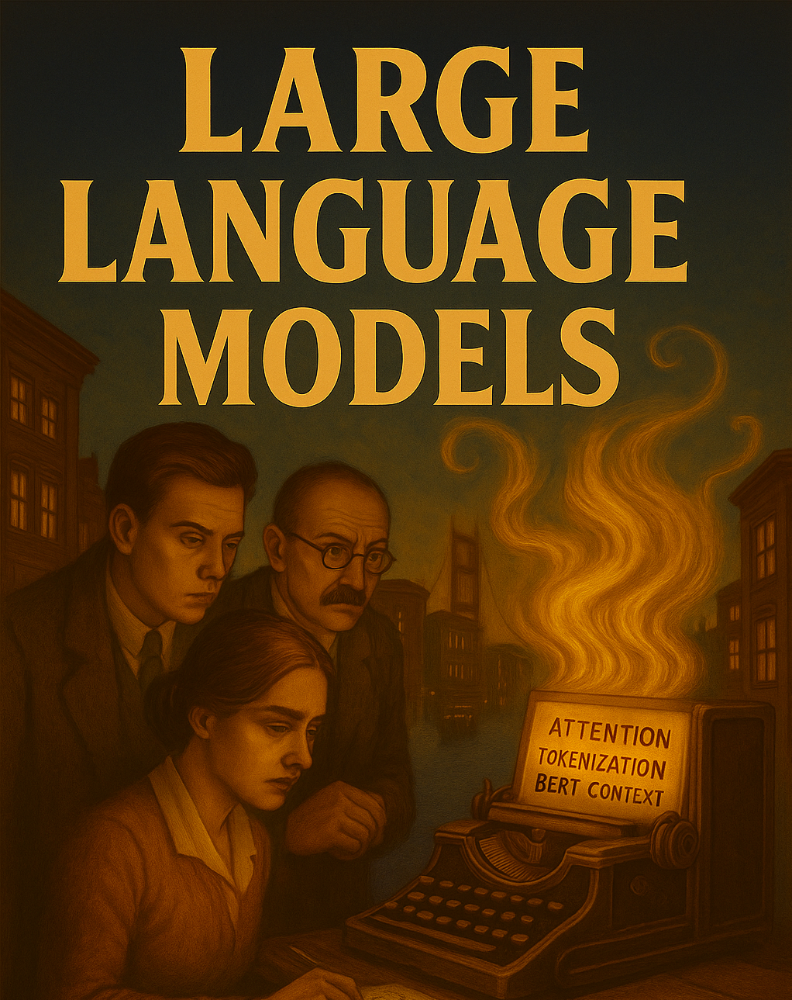

::::::: {.hero-section}
:::::: {.container}
::: {.hero-title}
Week 1 — LLMs, Harnesses & Setup
:::

::: {.hero-subtitle}
What is actually behind the chat box, when a paid subscription is worth it, what a harness adds — and getting one running on your machine
:::
::::::
:::::::

------------------------------------------------------------------------



This week starts where most people actually are: **you have used the free ChatGPT (or Claude, or Gemini) in a browser, and that's it.** That is a fine starting point — but it is roughly like having only ever used a calculator when a spreadsheet exists. By the end of this session you will understand what an LLM actually does, what happens when you share a document with one, when paying \$20/month is worth it (and when it isn't), what a **harness** is and why it changes everything for data work — and you will have at least one harness **installed and working** on your own machine.

This is the one lecture-heavy week. Everything after this is hands-on.

------------------------------------------------------------------------

## Before you come to class (30–60 min)

::::: {.week-card .card}
::: card-header
✅ **Pre-class checklist**
:::

::: card-body

- ☐ **Accounts** — create (free) accounts at [claude.ai](https://claude.ai) and [chatgpt.com](https://chatgpt.com) if you don't have them. If you are a student, claim the free **GitHub Student Developer Pack** at [education.github.com](https://education.github.com/pack) — it includes GitHub Copilot Pro at no cost.
- ☐ **One paid plan** — for this course you need *one* \$20-tier subscription that includes a coding agent: **Claude Pro** (recommended — the course demos use Claude Code) or **ChatGPT Plus** (includes Codex). Students with the GitHub pack can alternatively rely on Copilot. Details and comparison below — read that section first if unsure.
- ☐ **Install VS Code** — from [code.visualstudio.com](https://code.visualstudio.com/). Even if you use another editor, we use it in class.
- ☐ **Read** — [Which AI model](../da-knowledge/which-ai.qmd). That's the only required reading.
- ☐ **New to the terminal?** Skim [Terminal Basics](../da-knowledge/terminal-basics.qmd) — 10 minutes, and the hands-on block will feel much easier.

We finish installation together in class — don't worry if something fails at home.

:::
:::::

------------------------------------------------------------------------

## Learning objectives

By the end of this unit you will be able to:

- Explain what an LLM is, what tokens and a **context window** are, and what actually happens when you upload a document to a chat.
- Compare **free vs paid** subscription tiers and decide, for your own situation, when a subscription is worth it.
- Explain what a **harness** is, and what a coding agent like Claude Code adds on top of the same \$20 subscription — folder access, tool use, running code, managing agents.
- Install and authenticate at least one harness (**Claude Code**, **Codex**, or **GitHub Copilot**) — desktop app and CLI — and run a first real task in it.
- Describe the role of **OpenRouter / APIs** and **open-weights models on local hardware**, and say when each is the right choice.

------------------------------------------------------------------------

## Session shape (200 min · 40·40·60·40·20)

| Chunk | Focus | Mode |
|---|---|---|
| 1 (40) | What's behind the chat box — LLM concepts | Talk |
| 2 (40) | Free vs paid · documents & context · what a harness adds | Talk + demo |
| 3 (60) | Hands-on: install your harness (desktop first, then CLI) | Individual |
| 4 (40) | Hands-on: one real task, two surfaces | Individual |
| Discussion (20) | Trust, surfaces, the jagged frontier | Group |

------------------------------------------------------------------------

## Chunk 1 — What's behind the chat box (40 min · talk)

::::: {.week-card .card}
::: card-header
📊 **Core LLM concepts — no math required**
:::

::: card-body

**[Slideshow: LLM Concepts and Applications](https://gabors-data-analysis.com/courses/da-w-ai-2025/da-w-ai-01-llm-course.html)**

- **What an LLM is** — a statistical model that predicts the next *token* (word piece) given everything so far, trained on a huge slice of human text. No database of facts, no lookup — prediction. This one idea explains both the magic and the failure modes.
- **Tokens** — models don't see words or characters; they see tokens (~¾ of a word in English). Everything is metered in tokens: what you can fit in, what you pay for via API, how fast it responds.
- **The transformer** — how 2017's *"Attention Is All You Need"* made today's models possible. You don't need the details; you need the consequence: the model attends to *everything in its context at once*.
- **Training & feedback** — pre-training on text, then instruction-tuning and human feedback (RLHF). This is why models are helpful and polite, and also why they'd rather produce a confident wrong answer than say "I don't know."
- **The jagged frontier** — LLMs are superhuman at some tasks and surprisingly bad at adjacent ones, and the boundary is invisible until you test it. See [Mollick on AI jaggedness](https://www.oneusefulthing.org/p/the-shape-of-ai-jaggedness-bottlenecks).
- **Cyborg vs Centaur** — two ways to split work with AI (Mollick): the *Centaur* hands off whole sub-tasks; the *Cyborg* interleaves human and AI move-by-move. You'll feel both this term.

**The model landscape** (details in [Which AI model](../da-knowledge/which-ai.qmd)):

- **Frontier closed models** — Claude (Anthropic), GPT (OpenAI), Gemini (Google). State of the art; you rent them per month or per token.
- **Open-weights models** — Llama, Qwen, Mistral, DeepSeek, Kimi. You can download the weights and run them yourself; think of them as roughly SOTA-minus-a-few-months. Why they matter: **privacy, cost at scale, reproducibility**. We return to them at the end of today.

:::
:::::

::::: {.week-card .card}
::: card-header
🧠 **The context window — the concept that explains almost everything**
:::

::: card-body

The **context window** is the model's working memory: everything it can "see" at once — your messages, its answers, any files you shared. Current frontier models handle roughly 200K–1M tokens (a few hundred pages), and models are typically stronger early in the window than when it is stuffed full.

What follows from this single concept:

- **A new chat is a blank slate.** The model does not remember yesterday's conversation (unless the app injects a "memory" summary — that's a product feature, not the model).
- **Long chats degrade.** As the window fills up, earlier details get crowded out or attended to poorly. For serious work: start fresh chats per task, and re-state what matters.
- **What happens when you upload a document:** the file is converted to tokens and *placed into the context window*. Nothing is "learned"; the model reads it like a very fast skimmer. A 30-page PDF fits comfortably. A 180 MB CSV does **not** — the app will silently truncate, sample, or use a code tool to peek at it. If you don't know which happened, you can't trust the answer.
- **This is why data workflows need more than chat.** Real datasets don't fit in a context window. The professional pattern — which this whole course teaches — is: give the model the *codebook, column lists, and small samples*, and have it write **code** that processes the full data outside the window.

**Privacy — where your documents go.** An uploaded file goes to the provider's servers. On consumer plans, chats may be used to train future models depending on your data settings — check them (ChatGPT: *Settings → Data controls*; Claude: privacy settings). Paid business/enterprise tiers and API access come with stronger no-training guarantees. House rule for this course: **nothing confidential goes into a chat you wouldn't put in an email to an outside company.**

:::
:::::

------------------------------------------------------------------------

## Chunk 2 — Free vs paid, and what a harness adds (40 min · talk + demo)

::::: {.week-card .card}
::: card-header
💳 **Free vs paid — the honest comparison**
:::

::: card-body

All major providers run the same ladder. Prices as of mid-2026 (check current pages before subscribing):

| Tier | ChatGPT | Claude | What you actually get |
|---|---|---|---|
| **Free** | \$0 (with ads in some countries) | \$0 | Limited messages that fall back to smaller models when you hit the cap; limited file upload; smallest context; fine for casual questions |
| **Budget** | Go — ~\$8/mo | — | More messages on mid-tier models |
| **Standard** | Plus — \$20/mo | Pro — \$20/mo | The full frontier models incl. extended thinking, deep research, projects, big file uploads, **and the coding agent (Codex / Claude Code)** |
| **Power** | Pro — \$100–200/mo | Max — \$100–200/mo | 5×–20× the usage limits, best-model access all day |

(Gemini has the same shape: free tier and Google AI Pro at ~\$20/mo. GitHub Copilot is the outlier: ~\$10/mo, **free for verified students and teachers**.)

**What the free tier really costs you** for data work: you get routed to smaller models mid-conversation, you can't attach much, deep research and thinking modes are capped or absent — and crucially, **you don't get the coding agent**.

**When should you subscribe? A rule of thumb:**

- If you use AI a few times a week to look things up or draft a paragraph → **free is fine.**
- If you do analytical work (coding, data, writing reports) more than ~2–3 hours a week → the **\$20 tier pays for itself in the first afternoon.** One consultant-hour costs more.
- The \$100+ tiers are for people who run agents much of the day. You will not need them for this course.
- **For this course, a \$20 tier that includes a coding agent is effectively required** — that's Claude Pro or ChatGPT Plus (or student Copilot).

:::
:::::

::::: {.week-card .card}
::: card-header
🔧 **Harnesses — the model is the engine, the harness is the car**
:::

::: card-body

A **harness** is the software wrapped around a model that lets it actually *do* things. The chat website is one harness — the simplest one. A **coding agent** like Claude Code, Codex, or Copilot is a different harness around *the same model*, and it is the reason this course exists.

Here is what changes, on the same \$20 subscription:

| | Chat app (browser) | Harness / coding agent |
|---|---|---|
| **Files** | You upload them one by one, into the context window | It **reads your folders directly** — a whole project of CSVs, scripts, PDFs, hundreds of files, fetching what it needs when it needs it |
| **Code** | Writes snippets; maybe runs them in a remote sandbox | **Writes, runs, and debugs code on your machine**, sees the error, fixes it, reruns |
| **Output** | Text you copy-paste | **Real files**: edited scripts, saved figures, cleaned CSVs, reports |
| **Tools** | Fixed set (search, maybe a sandbox) | **Tool use**: shell, git, package installs, web fetch, your own scripts, MCP connectors |
| **Scale of work** | One answer per prompt | **Agentic loops**: plans multi-step tasks, works for minutes to hours, can manage **sub-agents** working in parallel |
| **Memory across sessions** | Product "memory," opaque | **Instruction files you control** (`CLAUDE.md` / `AGENTS.md`): project conventions the agent reads every time |

So: the \$20 chat subscription answers questions; the *same* \$20 pointed at a harness **does the work with you** — on a great deal of material, in your folders, with tools, verifiably. The trade: it runs on *your* machine with real permissions, so you also learn safety habits (it asks before running commands; you review diffs; git is your undo button).

**The three harnesses on the menu today** (skills transfer 1:1 between them):

| Harness | Comes with | Surfaces |
|---|---|---|
| **[Claude Code](https://code.claude.com/docs)** (course default) | Claude Pro/Max \$20+ | Desktop app · terminal CLI · VS Code extension |
| **[Codex](https://developers.openai.com/codex)** | ChatGPT Plus/Pro \$20+ | ChatGPT desktop app · terminal CLI · IDE extension |
| **[GitHub Copilot](https://github.com/features/copilot)** | ~\$10/mo, free for students | VS Code (agent mode) · terminal CLI |

**Awareness, not required:** there are also [open-code harnesses](../da-knowledge/open-code-tools.qmd) — open-source agents you point at any model, including a local one. Same workflow, swappable engine.

:::
:::::

------------------------------------------------------------------------

## Chunk 3 — Hands-on: install your harness (60 min · individual)

Set up **at least one** tool fully — desktop *and* CLI. Course demos use Claude Code, so that's the default; if your subscription is ChatGPT or Copilot, use the matching tab. (Full reference: [Installing AI CLI Tools](../da-knowledge/install-cli.qmd).)

**Why desktop first, then CLI?** The desktop app is the friendly on-ramp: sign in, point it at a folder, go. The CLI is the same agent in the terminal — more control, scriptable, and the surface we'll use for real pipelines from Week 3 on. You want both working.

::::: {.week-card .card}
::: card-header
🟠 **Option A — Claude Code (course default)**
:::

::: card-body

**Step 1 — Desktop app.** Download from [claude.com/product/claude-code](https://claude.com/product/claude-code), install, sign in with your Claude account. Create a folder `my-first-agent` with any CSV in it, open the folder in the app, and ask: *"What's in this folder? Describe the CSV."* Watch it read your files and ask permission before acting — that permission dialog is the safety model.

**Step 2 — CLI.**

::: {.panel-tabset}
#### Windows
In PowerShell:
```
irm https://claude.ai/install.ps1 | iex
```
Then close and reopen the terminal.

#### Mac
```bash
curl -fsSL https://claude.ai/install.sh | bash
```
Or: `brew install claude`

#### Linux
```bash
curl -fsSL https://claude.ai/install.sh | bash
```
:::

**Step 3 — Launch and authenticate.**

```bash
cd my-first-agent
claude
```

First run opens a browser window to log in — pick your Claude subscription. Then try `/help`, and ask the same folder question you asked the desktop app.

:::
:::::

::::: {.week-card .card}
::: card-header
⚪ **Option B — Codex (with ChatGPT Plus)**
:::

::: card-body

**Step 1 — Desktop app.** The ChatGPT desktop app ([download](https://chatgpt.com/download)) now includes Codex: sign in with your ChatGPT account, open the **Codex** tab, and point it at a local folder. Same experiment: *"What's in this folder?"*

**Step 2 — CLI.**

::: {.panel-tabset}
#### Windows
In PowerShell:
```
powershell -ExecutionPolicy ByPass -c "irm https://chatgpt.com/codex/install.ps1 | iex"
```

#### Mac
```bash
curl -fsSL https://chatgpt.com/codex/install.sh | sh
```
Or: `npm install -g @openai/codex`

#### Linux
```bash
curl -fsSL https://chatgpt.com/codex/install.sh | sh
```
:::

**Step 3 — Launch and authenticate.**

```bash
cd my-first-agent
codex
```

Choose **Sign in with ChatGPT** (uses your Plus plan — no API key needed).

:::
:::::

::::: {.week-card .card}
::: card-header
⚫ **Option C — GitHub Copilot (free for students)**
:::

::: card-body

**Step 1 — VS Code first** (Copilot's "desktop" is your editor). Install the **GitHub Copilot** extension in VS Code, sign in with the GitHub account that has your Copilot access, open Copilot Chat (`Ctrl+Shift+I` / `Cmd+Shift+I`) and switch it to **Agent** mode. Full guide: [VS Code + Copilot setup](../da-knowledge/vscode-setup.qmd).

**Step 2 — Copilot CLI.**

::: {.panel-tabset}
#### Windows
```
winget install GitHub.Copilot
```
Or: `npm install -g @github/copilot` (needs Node.js 22+)

#### Mac
```bash
brew install --cask copilot-cli
```
Or: `npm install -g @github/copilot`

#### Linux
```bash
npm install -g @github/copilot
```
:::

**Step 3 — Launch and authenticate.**

```bash
cd my-first-agent
copilot
```

Sign in with GitHub when prompted.

:::
:::::

::: {.callout-tip}
**Setup verified when:** (1) the desktop app can read a local folder; (2) the CLI launches in a folder, authenticates, and answers *"what's in this folder?"* by actually listing your files. If you finish early, set up a **second** tool — comparing harnesses is part of Chunk 4.
:::

------------------------------------------------------------------------

## Chunk 4 — Hands-on: one real task, two surfaces (40 min · individual)

::::: {.week-card .card}
::: card-header
🎯 **The task: a small, checkable analysis**
:::

::: card-body

Don't just look up data — make something. Run this **same prompt** on (a) the plain chat app in the browser, and (b) your harness (desktop or CLI):

> *"Get Connecticut median household income by county for 2023, load it into a dataframe, and make one labelled bar chart sorted high to low. Save the chart as a PNG."*

For each surface, note:

- **Did it actually run** the code and produce a PNG on your disk, or just hand you a snippet?
- **Was the data right?** Open the numbers and compare to the [Census/ACS source](https://data.census.gov/). Flag anything invented. (Connecticut switched from counties to planning regions — did the AI mention that, or quietly paper over it?)
- **How many turns** did it take to get a correct chart?

| Surface | Ran the code? | PNG on disk? | Data correct? | Turns needed |
|---|---|---|---|---|
| Chat app (browser) | | | | |
| Harness (desktop or CLI) | | | | |

This tiny table is the raw material for your delivery note — and your first data point on the chat-vs-harness question.

:::
:::::

------------------------------------------------------------------------

## Closing talk — beyond subscriptions: OpenRouter & local models

::::: {.week-card .card}
::: card-header
🌐 **OpenRouter — one key, every model**
:::

::: card-body

Subscriptions are one door to the models; the other is the **API** — pay per token, no monthly fee. [OpenRouter](https://openrouter.ai/models) is a marketplace that puts *hundreds* of models (frontier and open-weights) behind **one API key and one bill**. Why an analyst cares:

- **Compare models on your task** — run the same prompt through Claude, GPT, Gemini, DeepSeek, Kimi and diff the answers.
- **Cheap bulk work** — classifying 100,000 texts (as in our capstone) through an open-weights model can cost a few dollars instead of a few hundred.
- **One integration** — most harnesses and libraries accept an OpenRouter endpoint; you swap models by changing one string.

We use APIs seriously in Week 5 and the capstone — see [Get AI API keys](../da-knowledge/get-ai-api-key.qmd) when you get there.

:::
:::::

::::: {.week-card .card}
::: card-header
🦙 **Running an open-weights model on your own computer**
:::

::: card-body

The final rung of independence: download the weights, run the model locally. **Nothing leaves your machine** — the answer to privacy, offline work, and perfectly reproducible ("frozen") models. The easy on-ramp is [Ollama](https://ollama.com/) or [LM Studio](https://lmstudio.ai/).

**What machine do you need?** The model must fit in your GPU memory (VRAM) or a Mac's unified memory:

| Model size | Hardware needed | What it's like |
|---|---|---|
| 3–4B | Any modern laptop, 8 GB RAM | Autocomplete-plus; fine for drafts and simple extraction |
| 7–8B | 16 GB RAM laptop or 8 GB VRAM GPU | Genuinely useful for summarising, classification, simple code |
| 14–32B | 24 GB VRAM GPU (RTX 4090/5090-class) or 32 GB+ Apple Silicon | Solid mid-tier assistant; the sweet spot for local |
| 70B | 48–64 GB — big GPU rig or 64–128 GB Mac | Approaches last year's frontier |
| Frontier-scale open models (DeepSeek, Kimi) | Server-class, multiple GPUs | Don't run these at home — rent them via OpenRouter |

Try it if curious: `ollama run llama3.2` and give it the Connecticut prompt. Feel the capability gap versus the frontier model — that gap *is* the price of privacy. Full orientation: [Open-weights & local models](../da-knowledge/open-weights-models.qmd).

:::
:::::

------------------------------------------------------------------------

## Discussion (20 min)

- Chat vs harness on the same task — what concretely changed? What did the harness do that the browser couldn't?
- When would *you* pay \$20? When \$0? Is there any task in your life worth \$100/month?
- Documents and privacy: what would you upload to a free chat, a paid chat, an API, a local model? Draw your personal line.
- The jagged frontier — what did the AI nail, and where did it quietly get the Connecticut data wrong? How did you catch it?

------------------------------------------------------------------------

## Delivery

::::: {.week-card .card}
::: card-header
📦 **What to hand in (Sunday 23:55)**
:::

::: card-body

- **Working environment** — a screenshot of your harness (desktop *and* CLI) completing the Connecticut task, PNG visible on disk.
- **A short note (½ page):** (1) your chat-vs-harness comparison table with two sentences of interpretation; (2) which subscription/tool you'll use this term and why; (3) one thing the AI got wrong and how you caught it.

:::
:::::

------------------------------------------------------------------------

## Academic integrity & AI use

- **AI as assistant** — use AI to enhance your capabilities, not replace your thinking.
- **Maintain authority** — you remain responsible for all outputs and interpretations.
- **Verify everything** — always validate AI suggestions, especially statistical claims.
- **Document usage** — keep track of how AI helped, to learn and for transparency.

**Red lines:** never submit unverified AI output as your own; always understand the analysis you present; don't outsource critical thinking.

## Knowledge Base

- [Which AI model](../da-knowledge/which-ai.qmd) · [Glossary of LLM terms](../da-knowledge/technical-terms-page.qmd)
- [Installing AI CLI Tools](../da-knowledge/install-cli.qmd) · [VS Code + Copilot setup](../da-knowledge/vscode-setup.qmd) · [Terminal Basics](../da-knowledge/terminal-basics.qmd)
- [Open-weights & local models](../da-knowledge/open-weights-models.qmd) · [Open-code tools](../da-knowledge/open-code-tools.qmd)
- [Get AI API keys](../da-knowledge/get-ai-api-key.qmd) — for later weeks

## Further reading (optional)

- Ethan Mollick, *Co-Intelligence: Living and Working with AI* — Chapters 1–2 for the Cyborg/Centaur framing.
- [Mollick — The shape of AI jaggedness](https://www.oneusefulthing.org/p/the-shape-of-ai-jaggedness-bottlenecks)
- [Attention Is All You Need (2017)](https://arxiv.org/abs/1706.03762) — the transformer paper, if you're curious about the engine.
- [Claude Code documentation](https://code.claude.com/docs) · [Codex documentation](https://developers.openai.com/codex) · [Copilot CLI](https://docs.github.com/en/copilot/how-tos/copilot-cli)
